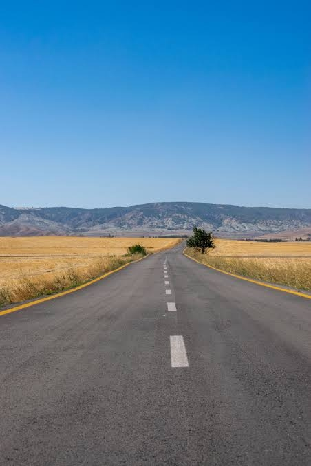
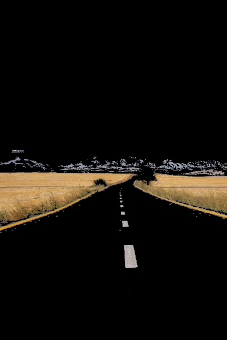
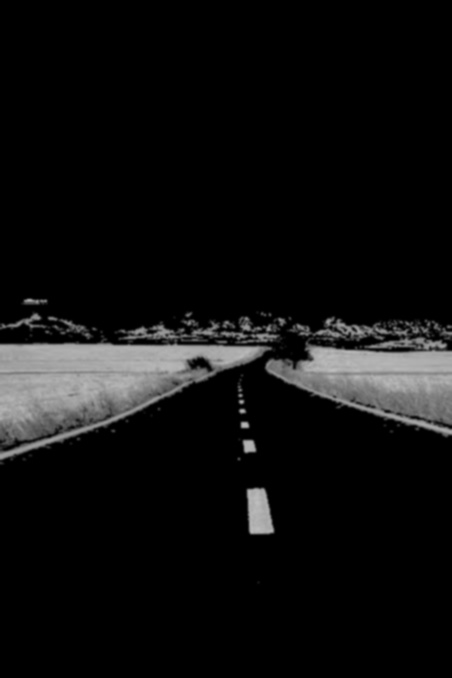
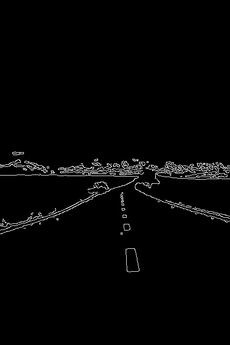
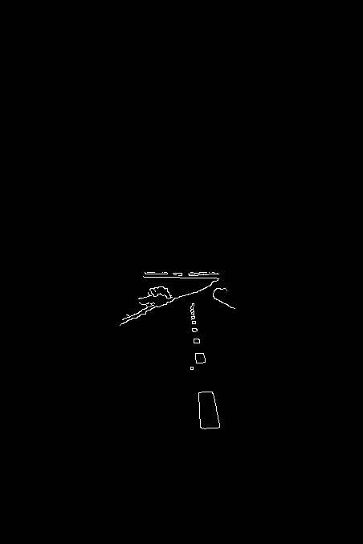

# lane-line-extractor

A robust, modular Python script built with OpenCV to extract highway lane lines from static images using classical computer vision techniques.

## Assignment Overview & Pipeline Steps
1. **Image Loading:** Loads the user-input image dynamically and extracts resolution details.
2. **HSV Color Filtering:** Isolates white and yellow lane markings using custom HSV color thresholds.
3. **Gaussian Blur:** Smooths out image noise before edge detection.
4. **Canny Edge Detection:** Identifies strong gradient boundaries and lane edges.
5. **Dynamic Region of Interest (ROI) Masking:** Applies a custom polygonal mask to filter out background noise (sky, fields) and isolate the road.

## Pipeline Visualizations

### 1. Original Image

### 2. HSV Color Filtered

### 3. Gaussian Blur

### 4. Canny Edge Detection

### 5. Final Region of Interest (ROI) Extracted Lanes

